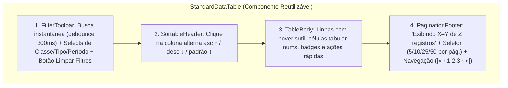
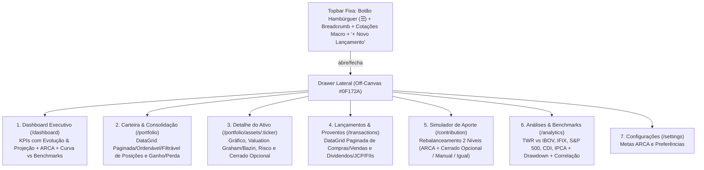

# Arquitetura Frontend e Design System (UI/UX) — Financial Control

> Especificação arquitetural de Frontend (`apps/web`), Design System (paleta Azul, Branco e Cinza), Layout Full-Canvas com **Menu Hambúrguer (Off-Canvas Drawer)**, Cards com Indicadores de Evolução e Projeção, e **Padrão Universal de Tabelas (`DataGrid`) com Paginação, Ordenação e Filtros Server/Client-Side**.

---

## 1. Diretrizes de Layout & Design System (Azul, Branco e Cinza)

### 1.1 Aproveitamento Máximo de Tela (Hamburger Navigation + Full-Width Canvas)
Para garantir que gráficos financeiros, cards de evolução/projeção e tabelas analíticas aproveitem **100% da largura útil da viewport**:
- **Sem Sidebar Fixa Permanente**: a navegação principal fica recolhida em um **Menu Hambúrguer (`NavigationDrawer`)** acionado no canto superior esquerdo da Topbar (`☰` ou atalho `Alt+M`), abrindo em sobreposição (*slide-over drawer* em azul-marinho `#0F172A` com backdrop translúcido).
- **Topbar Clean (`64px`)**:
  - Esquerda: Botão Hambúrguer + Breadcrumb da página atual + Ticker tape compacto (`CDI`, `IPCA`, `USD/BRL`, `IBOV`, `IFIX`).
  - Direita: Seletor global de janela temporal (`1M`, `6M`, `12M`, `YTD`, `Máx`) + botão primário `+ Novo Lançamento`.
- **Grid de Conteúdo (`max-w-[1600px] mx-auto px-6 py-6 gap-6`)**: espaçamento respirável (`24px` entre seções, `20px` de padding interno nos cards), bordas sutis `#E2E8F0` e sombras leves.

### 1.2 Tokens de Cores (Azul, Branco e Cinza)

| Categoria | Token CSS | Hex | Uso na Interface |
|---|---|---|---|
| **Superfícies (Branco / Cinza Claro)** | `--surface-canvas` | `#F8FAFC` | Fundo geral da página (`Slate 50`) |
| | `--surface-card` | `#FFFFFF` | Cards, tabelas, barra de filtros e topbar (`Pure White`) |
| | `--surface-subtle` | `#F1F5F9` | Cabeçalhos de tabela, paginação, badges neutros (`Slate 100`) |
| | `--surface-drawer` | `#0F172A` | Drawer do Menu Hambúrguer em azul-marinho profundo (`Slate 900`) |
| **Azul Principal (Brand & Actions)** | `--brand-primary` | `#1D4ED8` | Botões primários, página ativa da tabela, destaques (`Blue 700`) |
| | `--brand-primary-hover` | `#1E40AF` | Hover de ações primárias (`Blue 800`) |
| | `--brand-accent` | `#2563EB` | Indicadores de projeção, linha principal e sparklines (`Blue 600`) |
| | `--brand-soft` | `#EFF6FF` | Pílulas de projeção, linha selecionada e cabeçalho ativo (`Blue 50`) |
| **Escala de Cinzas (Tipografia e Bordas)** | `--text-primary` | `#0F172A` | Títulos e valores monetários principais (`Slate 900`) |
| | `--text-secondary` | `#475569` | Rótulos, subtítulos e células secundárias (`Slate 600`) |
| | `--text-muted` | `#94A3B8` | Placeholders, legendas e metadados (`Slate 400`) |
| | `--border-subtle` | `#E2E8F0` | Divisórias de cards e linhas de tabela (`Slate 200`) |
| **Cores das 4 Classes ARCA** | `--arca-stocks` | `#1D4ED8` | **A** — Ações Brasil (Azul Royal) |
| | `--arca-real-estate` | `#0284C7` | **R** — Real Estate / FIIs / REITs (Azul Céu Escuro) |
| | `--arca-cash` | `#475569` | **C** — Caixa / Renda Fixa (Cinza Ardósia) |
| | `--arca-international` | `#3B82F6` | **A** — Ativos Internacionais & Cripto (Azul Brilhante) |

---

## 2. Padrão de Cards com Indicadores de Evolução e Projeção

Todos os cards executivos (KPIs) seguem uma anatomia padronizada de **4 camadas de informação** com espaçamento limpo:
1. **Cabeçalho do Card**: Título da métrica em cinza (`#475569`) + ícone/badge de contexto.
2. **Valor Principal + Mini Sparkline**: Valor em destaque (`text-2xl font-bold tabular-nums`) acompanhado de micro-gráfico de linha indicando a trajetória recente.
3. **Indicador de Evolução (Realizado/Histórico)**: Pílula de variação no período (ex.: `▲ +2,45% no mês | +13,55% em 12m` vs CDI/IPCA).
4. **Indicador de Projeção (Forward-Looking 12m)**: Rodapé separado por linha sutil (`border-slate-100`) exibindo a **projeção estimada para os próximos 12 meses** com base nas taxas contratadas (curva CDI/IPCA+ da Renda Fixa), *Yield on Cost* de proventos e ritmo de aportes.

---

## 3. Padrão Obrigatório de Listagens e Tabelas (`StandardDataTable<T>`)

Toda listagem de dados na API e no Frontend (Posições da Carteira, Consolidação de Ganho/Perda, Histórico de Transações, Histórico de Proventos, Busca de Ativos e Auditoria do Cerrado) implementa obrigatoriamente o contrato padronizado de **Paginação, Ordenação e Filtros**.

### 3.1 Contrato Padronizado de Query & Resposta na API (`FastAPI`)

- **Query Parameters Padrão**:
  - `page`: número da página (1-indexed, default `1`)
  - `page_size`: itens por página (`10`, `25`, `50`, `100`, default `10`)
  - `sort_by`: campo de ordenação (ex.: `ticker`, `invested_value`, `current_value`, `consolidated_pnl`, `trade_date`)
  - `sort_order`: `asc` | `desc`
  - `search`: busca textual livre (ticker, nome, notas)
  - Filtros de domínio específicos (ex.: `arca_class`, `asset_type`, `kind`, `date_from`, `date_to`, `cerrado_status`)

- **Envelope JSON Padronizado (`PaginatedResponse<T>`)**:
```json
{
  "items": [ ... ],
  "meta": {
    "page": 1,
    "page_size": 10,
    "total_items": 48,
    "total_pages": 5,
    "has_prev": false,
    "has_next": true,
    "sort_by": "consolidated_pnl",
    "sort_order": "desc"
  },
  "summary": {
    "filtered_invested_value": 210000.00,
    "filtered_current_value": 238450.00,
    "filtered_consolidated_pnl": 42190.00
  }
}
```

### 3.2 Anatomia do Componente `StandardDataTable<T>` no Frontend



---

## 4. Hierarquia de Navegação (Hamburger Drawer + Full Viewport)


