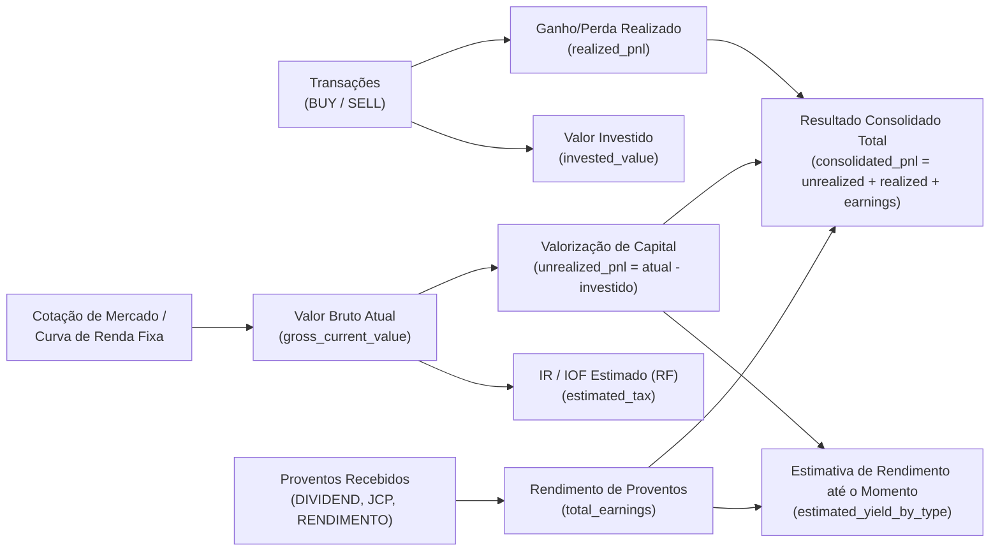
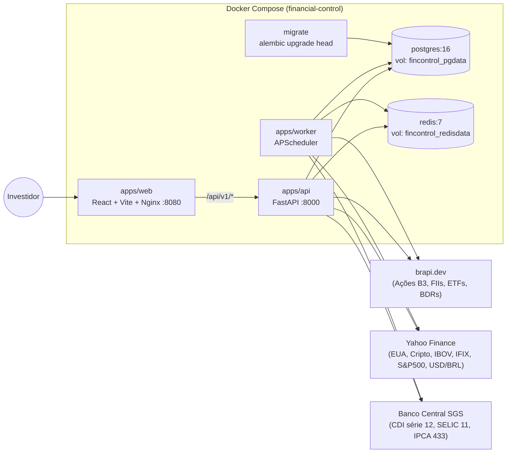
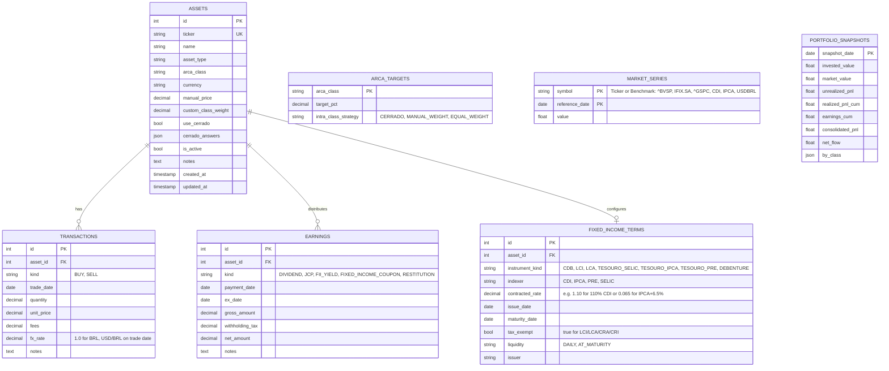
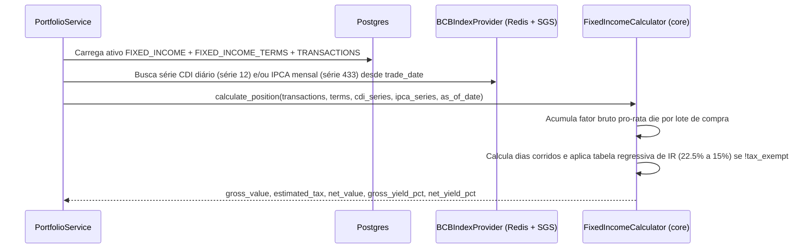
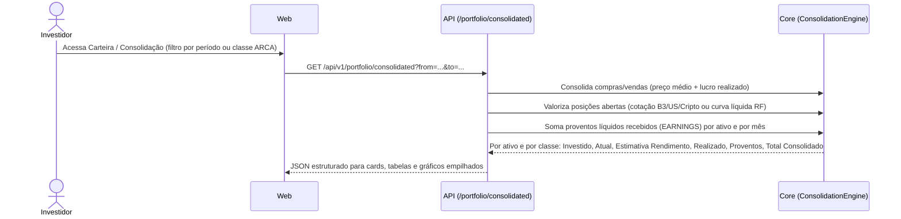
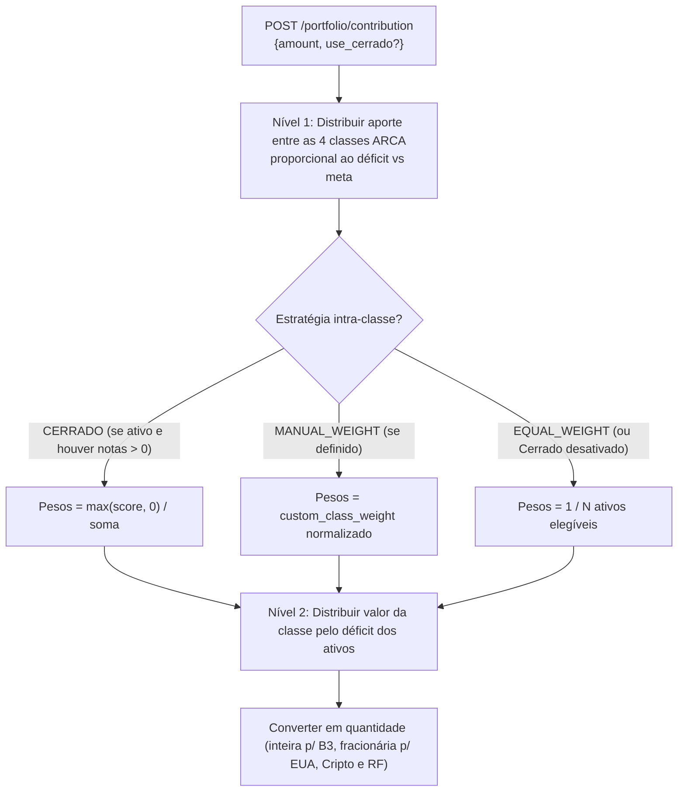

# Arquitetura e Visão Sistêmica — Financial Control

> Solução para controle, acompanhamento e análise de carteira de investimentos baseada na distribuição **ARCA** (Thiago Nigro) e no **Diagrama do Cerrado** opcional (Raul Sena), com cálculo automático de renda fixa por indexador, controle de proventos, consolidação de ganhos/perdas e métricas quantitativas de mercado.

---

## 1. Visão Geral do Domínio

### 1.1 Distribuição ARCA (Macroalocação)
A carteira é dividida em quatro classes com metas percentuais configuráveis (soma = 100%, padrão 25% cada):

| Letra | Classe (`ArcaClass`) | Tipos de Ativo (`AssetType`) | Meta Padrão |
|---|---|---|---|
| **A** | `ACOES` (Ações Brasil) | `STOCK_BR`, `ETF_BR` | 25% |
| **R** | `REAL_ESTATE` (Imobiliário) | `FII`, `REIT` | 25% |
| **C** | `CAIXA` (Caixa / Renda Fixa) | `FIXED_INCOME`, `TREASURY`, `CASH` | 25% |
| **A** | `ATIVOS_INTERNACIONAIS` | `STOCK_INTL`, `ETF_INTL`, `BDR`, `CRYPTO` | 25% |

### 1.2 Seleção Intra-Classe: Diagrama do Cerrado (Opcional)
O **Diagrama do Cerrado** **não é obrigatório**. O sistema oferece três modos de distribuição intra-classe (`IntraClassStrategy`):
1. **`CERRADO`** (padrão quando avaliado): peso proporcional à pontuação positiva do questionário ($\max(\text{score}, 0)$). Ativos com nota $\le 0$ ficam com status `REVISAR` e peso $0$.
2. **`MANUAL_WEIGHT`**: o investidor define manualmente o peso-alvo do ativo dentro da classe (`custom_class_weight`).
3. **`EQUAL_WEIGHT`**: peso igualitário ($1/N$) entre os ativos ativos da classe (fallback automático quando o usuário não usa o Cerrado nem pesos manuais).

### 1.3 Valores da Carteira, Rendimento Estimado e Consolidação de Ganho/Perda
Para cada ativo cadastrado e para o consolidado da carteira (por classe ARCA e geral), o sistema calcula:

#### Estimativa de rendimento até o momento por tipo de ativo (`AssetType`)
| Tipo de Ativo | Como é calculada a Estimativa de Rendimento até o momento |
|---|---|
| **`STOCK_BR` / `STOCK_INTL` / `BDR`** | Valorização da cotação sobre o preço médio $(\text{Preço Atual} - \text{PM}) \times \text{Qtd}$ **+** Dividendos e JCP líquidos recebidos + Dividend Yield estimado para os próximos 12m (*Yield on Cost* = $\text{Proventos 12m} / \text{Custo Investido}$). |
| **`FII` / `REIT`** | Valorização das cotas **+** Rendimentos isentos distribuídos no período + estimativa de renda mensal recorrente baseada no DY de 12 meses. |
| **`ETF_BR` / `ETF_INTL` / `CRYPTO`** | Ganho de capital pela cotação atual em BRL (considerando câmbio USD/BRL) sobre o custo investido. |
| **`FIXED_INCOME` / `TREASURY`** | Marcação na curva contratada desde a data de aplicação até hoje: acumulação diária do **CDI** ($\prod (1 + \text{CDI}_d \times \%_{\text{contratado}})$), **IPCA + taxa real** ($\prod (1 + \text{IPCA}_m) \times (1 + r_{\text{anual}})^{\text{du}/252}$) ou **Prefixado** ($(1 + r_{\text{anual}})^{\text{du}/252}$), demonstrando **Rendimento Bruto**, **Alíquota Regressiva de IR / IOF** e **Rendimento Líquido**. |
| **`CASH`** | Saldo disponível / remuneração automática parametrizada (ex.: 100% CDI diário). |

#### Consolidação de Ganho / Perda / Rendimento Obtido (`ConsolidatedPerformance`)
Visão que permite auditar o resultado fechado e aberto por ativo, por classe ARCA, por mês/ano ou de toda a carteira:
- **Capital Investido Atual (`current_invested`)**: Custo das posições abertas.
- **Patrimônio Atual (`current_value`)**: Valor de mercado / curva líquida das posições abertas.
- **Ganho/Perda Não Realizado (`unrealized_pnl`)**: $\text{Patrimônio Atual} - \text{Capital Investido Atual}$.
- **Ganho/Perda Realizado em Vendas (`realized_pnl`)**: Soma de $\text{Qtd Vendida} \times (\text{Preço Venda} - \text{PM}) - \text{Taxas}$.
- **Proventos Recebidos (`received_earnings`)**: Soma líquida de Dividendos, JCP, Rendimentos de FII e Cupons recebidos.
- **Resultado Consolidado Total (`total_consolidated_pnl`)**:
  $$\text{Resultado Consolidado} = \text{Ganho/Perda Não Realizado} + \text{Ganho/Perda Realizado} + \text{Proventos Recebidos}$$
- **Retorno Total sobre o Capital (`total_return_pct`)** e **TWR (`time_weighted_return`)** comparados contra **CDI**, **IPCA**, **IBOV**, **IFIX** e **S&P 500**.

---

## 2. Diagrama de Contexto e Containers (C4)

---

## 3. Modelo de Dados (ER)

Todas as tabelas e colunas são definidas em **inglês** e versionadas via migrations Alembic (`script_00001`, `script_00002`, ...):

---

## 4. Fluxos Principais

### 4.1 Cálculo Automático de Renda Fixa

### 4.2 Consolidação de Ganho / Perda / Rendimento

### 4.3 Simulação de Aporte (com Cerrado Opcional)

---

## 5. Benchmarks e Indicadores Analíticos

| Código | Descrição | Fonte | Uso Principal |
|---|---|---|---|
| **`^BVSP`** | Ibovespa | brapi / yfinance | Benchmark de `ACOES` e carteira geral (Beta, Alpha, gráfico comparativo) |
| **`IFIX.SA`** | Índice de Fundos Imobiliários | brapi / yfinance | Benchmark da classe `REAL_ESTATE` (FIIs) |
| **`^GSPC`** | S&P 500 | yfinance | Benchmark da classe `ATIVOS_INTERNACIONAIS` |
| **`CDI`** | Taxa DI diária acumulada | BCB SGS (série 12) | Taxa livre de risco ($R_f$ para Sharpe/Sortino) e benchmark de `CAIXA` |
| **`IPCA`** | Inflação oficial mensal | BCB SGS (série 433) | Cálculo de ganho real acima da inflação e indexação de títulos IPCA+ |
