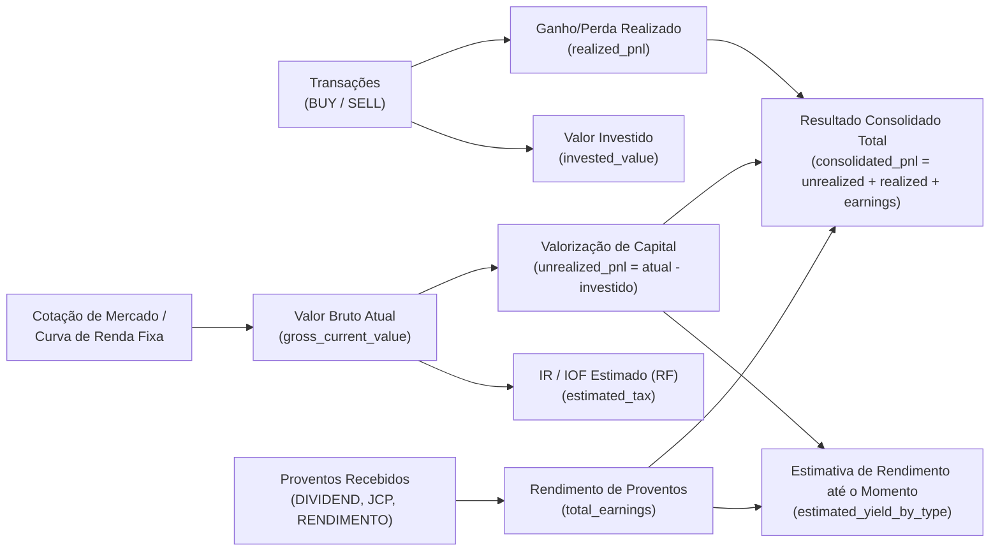
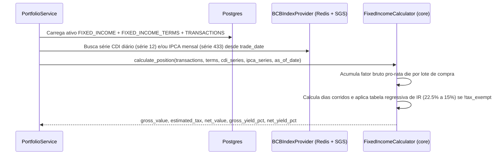
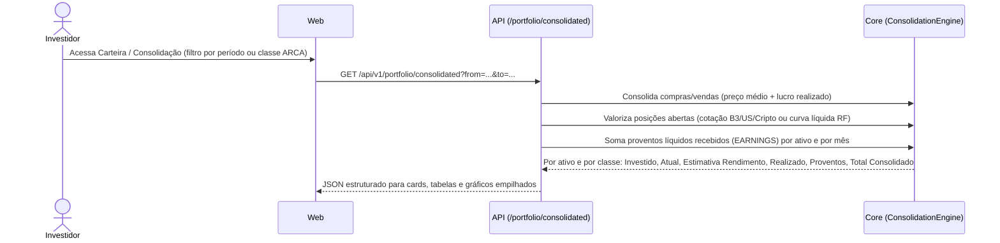
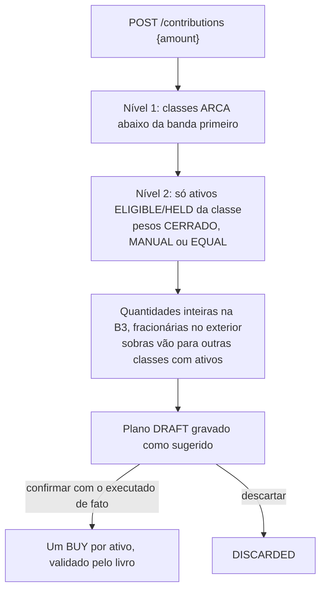

# Arquitetura e Visão Sistêmica — Financial Control

> Solução para controle, acompanhamento e análise de carteira de investimentos: **ARCA** (Thiago Nigro) para a segmentação da carteira e **análise fundamentalista** (checklist do Diagrama do Cerrado por perfil, histórico de demonstrativos e valuation por tipo) para escolher os ativos. As duas metodologias vivem numa **política de investimento versionada** e aparecem dentro de cada operação (ADR 0005): Pesquisar → Aportar → Lançamentos → Carteira/Desempenho.

---

## 1. Visão Geral do Domínio

### 1.1 Distribuição ARCA (Macroalocação)
A carteira é dividida em quatro classes com metas percentuais configuráveis (soma = 100%, padrão 25% cada):

| Letra | Classe (`ArcaClass`) | Tipos de Ativo (`AssetType`) | Meta Padrão |
|---|---|---|---|
| **A** | `ACOES` (Ações Brasil) | `STOCK_BR`, `ETF_BR` | 25% |
| **R** | `REAL_ESTATE` (Imobiliário) | `FII`, `REIT` | 25% |
| **C** | `CAIXA` (Caixa / Renda Fixa) | `FIXED_INCOME`, `TREASURY`, `CASH` | 25% |
| **A** | `ATIVOS_INTERNACIONAIS` | `STOCK_INTL`, `ETF_INTL`, `BDR`, `CRYPTO` | 25% |

### 1.2 Política de investimento e lente fundamentalista
A **política** (`investment_policies`, uma versão por alteração) reúne as regras das duas metodologias: metas e bandas ARCA com a estratégia intra-classe, critérios de **elegibilidade** (nota mínima e cobertura do checklist) e premissas de **valuation**.

- **Checklist v2 (Diagrama do Cerrado)** por perfil do instrumento (`STOCK`, `BANK`, `FII_BRICK`, `FII_PAPER`, `ETF`, `INTL_STOCK`, `CRYPTO`, `FIXED_INCOME`): respostas `YES`/`NO`/`NA`, manuais (com evidência) ou automáticas, preferindo métricas de até 5 anos de demonstrativos (ROE médio, CAGR, anos com lucro, regularidade de proventos) aos indicadores TTM. As respostas ficam num histórico append-only e a nota é registrada ao longo do tempo.
- **Valuation por perfil**: Graham, Bazin, P/L e EV/EBITDA (ações), P/VP justificado (bancos), P/VP, DY e spread sobre o juro real (FIIs); ETF, cripto e renda fixa não se aplicam.
- **Ciclo de vida** do ativo: `WATCHLIST` → `ELIGIBLE` → `HELD` → `REVIEW` → `ARCHIVED`. Só `ELIGIBLE` e `HELD` recebem aporte; `REVIEW` gera alerta, nunca venda automática.
- **Estratégia intra-classe** (`IntraClassStrategy`): `CERRADO` (peso pela nota positiva), `MANUAL_WEIGHT` ou `EQUAL_WEIGHT`. O checklist continua opcional (`use_cerrado`, `require_evaluation=false`).

### 1.3 Valores da Carteira, Rendimento Estimado e Consolidação de Ganho/Perda
Para cada ativo cadastrado e para o consolidado da carteira (por classe ARCA e geral), o sistema calcula:

#### Estimativa de rendimento até o momento por tipo de ativo (`AssetType`)
| Tipo de Ativo | Como é calculada a Estimativa de Rendimento até o momento |
|---|---|
| **`STOCK_BR` / `STOCK_INTL` / `BDR`** | Valorização da cotação sobre o preço médio $(\text{Preço Atual} - \text{PM}) \times \text{Qtd}$ **+** Dividendos e JCP líquidos recebidos + Dividend Yield estimado para os próximos 12m (*Yield on Cost* = $\text{Proventos 12m} / \text{Custo Investido}$). |
| **`FII` / `REIT`** | Valorização das cotas **+** Rendimentos isentos distribuídos no período + estimativa de renda mensal recorrente baseada no DY de 12 meses. |
| **`ETF_BR` / `ETF_INTL` / `CRYPTO`** | Ganho de capital pela cotação atual em BRL (considerando câmbio USD/BRL) sobre o custo investido. |
| **`FIXED_INCOME` / `TREASURY`** | Marcação na curva contratada desde a data de aplicação até hoje: acumulação diária do **CDI** ($\prod (1 + \text{CDI}_d \times \%_{\text{contratado}})$), **IPCA + taxa real** ($\prod (1 + \text{IPCA}_m) \times (1 + r_{\text{anual}})^{\text{du}/252}$) ou **Prefixado** ($(1 + r_{\text{anual}})^{\text{du}/252}$), demonstrando **Rendimento Bruto**, **Alíquota Regressiva de IR / IOF** e **Rendimento Líquido**. |
| **`CASH`** | Saldo disponível / remuneração automática parametrizada (ex.: 100% CDI diário). |

#### Consolidação de Ganho / Perda / Rendimento Obtido (`ConsolidatedPerformance`)
Visão que permite auditar o resultado fechado e aberto por ativo, por classe ARCA, por mês/ano ou de toda a carteira:
- **Capital Investido Atual (`current_invested`)**: Custo das posições abertas.
- **Patrimônio Atual (`current_value`)**: Valor de mercado / curva líquida das posições abertas.
- **Ganho/Perda Não Realizado (`unrealized_pnl`)**: $\text{Patrimônio Atual} - \text{Capital Investido Atual}$.
- **Ganho/Perda Realizado em Vendas (`realized_pnl`)**: Soma de $\text{Qtd Vendida} \times (\text{Preço Venda} - \text{PM}) - \text{Taxas}$.
- **Proventos Recebidos (`received_earnings`)**: Soma líquida de Dividendos, JCP, Rendimentos de FII e Cupons recebidos.
- **Resultado Consolidado Total (`total_consolidated_pnl`)**:
  $$\text{Resultado Consolidado} = \text{Ganho/Perda Não Realizado} + \text{Ganho/Perda Realizado} + \text{Proventos Recebidos}$$
- **Retorno Total sobre o Capital (`total_return_pct`)** e **TWR (`time_weighted_return`)** comparados contra **CDI**, **IPCA**, **IBOV**, **IFIX** e **S&P 500**.

---

## 2. Diagrama de Contexto e Containers (C4)

Rotinas do worker (cada execução fica em `job_runs`, com trava no Redis e novas tentativas):

| Rotina | Quando | O que faz |
|---|---|---|
| `warm_portfolio_quotes` | a cada `QUOTE_REFRESH_MINUTES` | renova cotações e fundamentos da carteira no cache |
| `ensure_series_coverage` | idem | completa séries BCB desde a aplicação de renda fixa mais antiga |
| `sync_bcb_and_benchmarks` | diário (`BCB_SYNC_CRON_*`) | sincroniza CDI/SELIC/IPCA e índices de forma incremental |
| `record_daily_snapshot` | dias úteis (`SNAPSHOT_CRON_*`) | grava o retrato diário da carteira (TWR) |
| `sync_instrument_catalog` | dias úteis (`CATALOG_SYNC_CRON_HOUR`) | catálogo de ativos B3 para o screener |
| `refresh_fundamentals` | semanal (`FUNDAMENTALS_CRON_*`) | demonstrativos anuais das empresas em carteira e em observação |
| `record_checklist_evaluations` | semanal | reavalia os checklists e registra a nota quando muda |

Falhas de provedor viram **fallback sinalizado** (cotação pelo preço médio, taxas padrão) e são lembradas por `MARKET_MISS_CACHE_TTL` para as telas responderem na hora; os alertas avisam o usuário.

---

## 3. Modelo de Dados (ER)

Tabelas e colunas em **inglês**, versionadas por migrations Alembic sequenciais (`script_00001` … `script_00015`):

```mermaid
erDiagram
    ACCOUNTS ||--o{ TRANSACTIONS : holds
    ACCOUNTS ||--o{ EARNINGS : receives
    ASSETS ||--o{ TRANSACTIONS : has
    ASSETS ||--o{ EARNINGS : distributes
    ASSETS ||--o| FIXED_INCOME_TERMS : configures
    ASSETS ||--o{ CORPORATE_EVENTS : adjusts
    ASSETS ||--o{ CHECKLIST_ANSWERS : answers
    ASSETS ||--o{ CHECKLIST_EVALUATIONS : scores
    ASSETS {
        int id PK
        string ticker UK
        string asset_type
        string arca_class
        string purpose "ARCA, EMERGENCY_RESERVE, OTHER"
        string checklist_profile "null means the default of the type"
        bool use_cerrado
        decimal manual_price
        bool is_active
    }
    ACCOUNTS {
        int id PK
        string name UK
        string kind "BROKER, BANK, EXCHANGE, OTHER"
    }
    TRANSACTIONS {
        int id PK
        int asset_id FK
        int account_id FK
        string kind "BUY, SELL"
        date trade_date
        decimal quantity
        decimal unit_price
        decimal fees
        decimal fx_rate
        string import_hash UK "B3 import deduplication"
    }
    EARNINGS {
        int id PK
        int asset_id FK
        int account_id FK
        string kind "DIVIDEND, JCP, FII_YIELD, FIXED_INCOME_COUPON, RESTITUTION"
        date payment_date
        decimal gross_amount
        decimal withholding_tax
        decimal fx_rate
        string import_hash UK
    }
    CORPORATE_EVENTS {
        int id PK
        int asset_id FK
        string kind "SPLIT, REVERSE_SPLIT, BONUS"
        date ex_date
        decimal factor
        decimal unit_cost "bonus attributed cost"
        string import_hash UK
    }
    CHECKLIST_ANSWERS {
        int id PK
        int asset_id FK
        string question_id
        string value "YES, NO, NA or null when cleared"
        string source "MANUAL, AUTO"
        text evidence
        timestamp answered_at
    }
    CHECKLIST_EVALUATIONS {
        int id PK
        int asset_id FK
        timestamp evaluated_at
        int score
        float coverage_pct
        string recommendation
    }
    INVESTMENT_POLICIES {
        int version PK
        json arca "targets, bands, intra-class strategy"
        json eligibility
        json valuation
    }
    FUNDAMENTAL_SNAPSHOTS {
        string ticker
        date reference_date
        string period "ANNUAL, TTM"
        json metrics
    }
    INSTRUMENT_CATALOG {
        string ticker PK
        string asset_type
        float volume_brl
    }
    CONTRIBUTION_PLANS {
        int id PK
        string status "DRAFT, CONFIRMED, DISCARDED"
        json payload "orders as suggested"
        json transaction_ids
    }
    MARKET_SERIES {
        string symbol
        date reference_date
        float value
        string unit "PERCENT_PER_DAY, PERCENT_PER_MONTH, PRICE, INDEX_POINTS"
    }
    PORTFOLIO_SNAPSHOTS {
        date snapshot_date PK
        decimal invested_value
        decimal market_value
        decimal consolidated_pnl
        decimal net_flow
    }
```

Também: `fixed_income_terms` (indexador, taxa contratada, emissão/vencimento, isenção), `job_runs` (execuções do worker) e `alert_dismissals` (alertas dispensados).

---

## 4. Fluxos Principais

### 4.1 Cálculo Automático de Renda Fixa

### 4.2 Consolidação de Ganho / Perda / Rendimento

### 4.3 Aporte: sugerir, revisar e confirmar

### 4.4 Pesquisa fundamentalista
`instrument_catalog` (lista B3 diária) → `GET /research/screener` (filtros de catálogo; indicadores só para os candidatos) → `POST /research/watchlist` (ativo `WATCHLIST`) → demonstrativos semanais, checklist e valuation em `GET /assets/{id}/analysis` → `ELIGIBLE` quando nota e cobertura atendem a política → recebe aporte.

### 4.5 Importação B3
Planilhas da Área do Investidor (Negociação e Movimentação) → pré-visualização por linha (`NEW`, `DUPLICATE`, `UNKNOWN_ASSET`, `IGNORED`, `INVALID`) → gravação tudo-ou-nada das linhas novas (hash de conteúdo + ocorrência), com eventos corporativos cujo fator sai da posição do dia anterior.

### 4.6 Alertas
`GET /alerts` combina carteira (livro inválido, classe fora da banda, ativo em revisão, cotação em fallback), valuation (abaixo do preço justo) e dados (série desatualizada, retrato ausente, rotina com falha); cada alerta tem chave estável e rota de ação, e pode ser dispensado por N dias.

---

## 5. Benchmarks e Indicadores Analíticos

| Código | Descrição | Fonte | Uso Principal |
|---|---|---|---|
| **`^BVSP`** | Ibovespa | brapi / yfinance | Benchmark de `ACOES` e carteira geral (Beta, Alpha, gráfico comparativo) |
| **`IFIX.SA`** | Índice de Fundos Imobiliários | brapi / yfinance | Benchmark da classe `REAL_ESTATE` (FIIs) |
| **`^GSPC`** | S&P 500 | yfinance | Benchmark da classe `ATIVOS_INTERNACIONAIS` |
| **`CDI`** | Taxa DI diária acumulada | BCB SGS (série 12) | Taxa livre de risco ($R_f$ para Sharpe/Sortino) e benchmark de `CAIXA` |
| **`IPCA`** | Inflação oficial mensal | BCB SGS (série 433) | Cálculo de ganho real acima da inflação e indexação de títulos IPCA+ |
