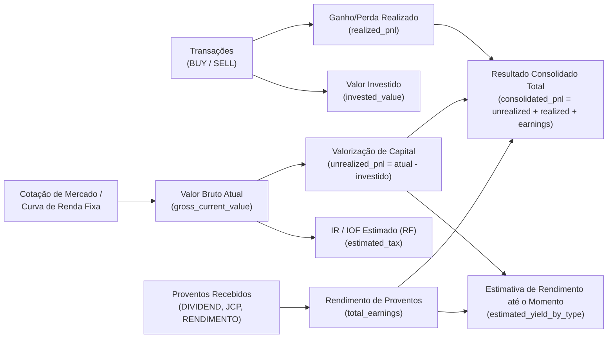
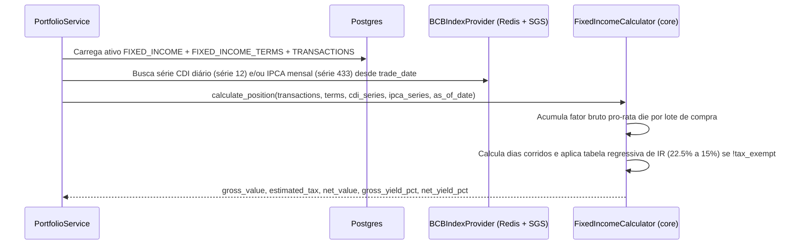
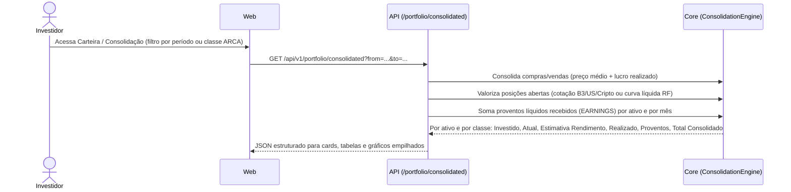
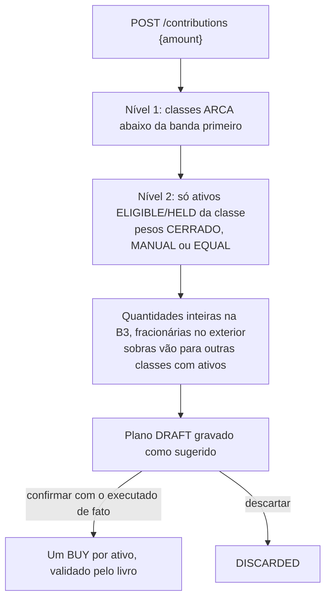

# Arquitetura e Visão Sistêmica — Financial Control

> Solução para controle, acompanhamento e análise de carteira de investimentos: **ARCA** (Thiago Nigro) para a segmentação da carteira e **análise fundamentalista** (checklist do Diagrama do Cerrado por perfil, histórico de demonstrativos e valuation por tipo) para escolher os ativos. As duas metodologias vivem numa **política de investimento versionada** e aparecem dentro de cada operação (ADR 0005): Pesquisar → Aportar → Lançamentos → Carteira/Desempenho.

---

## 1. Visão Geral do Domínio

### 1.1 Distribuição ARCA (Macroalocação)
A carteira é dividida em quatro classes com metas percentuais configuráveis (soma = 100%, padrão 25% cada):

| Letra | Classe (`ArcaClass`) | Tipos de Ativo (`AssetType`) | Meta Padrão |
|---|---|---|---|
| **A** | `ACOES` (Ações Brasil) | `STOCK_BR`, `ETF_BR` | 25% |
| **R** | `REAL_ESTATE` (Imobiliário) | `FII`, `REIT` | 25% |
| **C** | `CAIXA` (Caixa / Renda Fixa) | `FIXED_INCOME`, `TREASURY`, `CASH` | 25% |
| **A** | `ATIVOS_INTERNACIONAIS` | `STOCK_INTL`, `ETF_INTL`, `BDR`, `CRYPTO` | 25% |

### 1.2 Política de investimento e lente fundamentalista
A **política** (`investment_policies`, uma versão por alteração) reúne as regras das duas metodologias: metas e bandas ARCA com a estratégia intra-classe, critérios de **elegibilidade** (nota mínima e cobertura do checklist) e premissas de **valuation**.

- **Checklist v2 (Diagrama do Cerrado)** por perfil do instrumento (`STOCK`, `BANK`, `FII_BRICK`, `FII_PAPER`, `ETF`, `INTL_STOCK`, `CRYPTO`, `FIXED_INCOME`): respostas `YES`/`NO`/`NA`, manuais (com evidência) ou automáticas, preferindo métricas de até 5 anos de demonstrativos (ROE médio, CAGR, anos com lucro, regularidade de proventos) aos indicadores TTM. As respostas ficam num histórico append-only e a nota é registrada ao longo do tempo.
- **Valuation por perfil**: Graham, Bazin, P/L e EV/EBITDA (ações), P/VP justificado (bancos), P/VP, DY e spread sobre o juro real (FIIs); ETF, cripto e renda fixa não se aplicam.
- **Ciclo de vida** do ativo: `WATCHLIST` → `ELIGIBLE` → `HELD` → `REVIEW` → `ARCHIVED`. Só `ELIGIBLE` e `HELD` recebem aporte; `REVIEW` gera alerta, nunca venda automática.
- **Estratégia intra-classe** (`IntraClassStrategy`): `CERRADO` (peso pela nota positiva), `MANUAL_WEIGHT` ou `EQUAL_WEIGHT`. O checklist continua opcional (`use_cerrado`, `require_evaluation=false`).

### 1.3 Valores da Carteira, Rendimento Estimado e Consolidação de Ganho/Perda
Para cada ativo cadastrado e para o consolidado da carteira (por classe ARCA e geral), o sistema calcula:



#### Estimativa de rendimento até o momento por tipo de ativo (`AssetType`)
| Tipo de Ativo | Como é calculada a Estimativa de Rendimento até o momento |
|---|---|
| **`STOCK_BR` / `STOCK_INTL` / `BDR`** | Valorização da cotação sobre o preço médio $(\text{Preço Atual} - \text{PM}) \times \text{Qtd}$ **+** Dividendos e JCP líquidos recebidos + Dividend Yield estimado para os próximos 12m (*Yield on Cost* = $\text{Proventos 12m} / \text{Custo Investido}$). |
| **`FII` / `REIT`** | Valorização das cotas **+** Rendimentos isentos distribuídos no período + estimativa de renda mensal recorrente baseada no DY de 12 meses. |
| **`ETF_BR` / `ETF_INTL` / `CRYPTO`** | Ganho de capital pela cotação atual em BRL (considerando câmbio USD/BRL) sobre o custo investido. |
| **`FIXED_INCOME` / `TREASURY`** | Marcação na curva contratada desde a data de aplicação até hoje: acumulação diária do **CDI** ($\prod (1 + \text{CDI}_d \times \%_{\text{contratado}})$), **IPCA + taxa real** ($\prod (1 + \text{IPCA}_m) \times (1 + r_{\text{anual}})^{\text{du}/252}$) ou **Prefixado** ($(1 + r_{\text{anual}})^{\text{du}/252}$), demonstrando **Rendimento Bruto**, **Alíquota Regressiva de IR / IOF** e **Rendimento Líquido**. |
| **`CASH`** | Saldo disponível / remuneração automática parametrizada (ex.: 100% CDI diário). |

#### Consolidação de Ganho / Perda / Rendimento Obtido (`ConsolidatedPerformance`)
Visão que permite auditar o resultado fechado e aberto por ativo, por classe ARCA, por mês/ano ou de toda a carteira:
- **Capital Investido Atual (`current_invested`)**: Custo das posições abertas.
- **Patrimônio Atual (`current_value`)**: Valor de mercado / curva líquida das posições abertas.
- **Ganho/Perda Não Realizado (`unrealized_pnl`)**: $\text{Patrimônio Atual} - \text{Capital Investido Atual}$.
- **Ganho/Perda Realizado em Vendas (`realized_pnl`)**: Soma de $\text{Qtd Vendida} \times (\text{Preço Venda} - \text{PM}) - \text{Taxas}$.
- **Proventos Recebidos (`received_earnings`)**: Soma líquida de Dividendos, JCP, Rendimentos de FII e Cupons recebidos.
- **Resultado Consolidado Total (`total_consolidated_pnl`)**:
  $$\text{Resultado Consolidado} = \text{Ganho/Perda Não Realizado} + \text{Ganho/Perda Realizado} + \text{Proventos Recebidos}$$
- **Retorno Total sobre o Capital (`total_return_pct`)** e **TWR (`time_weighted_return`)** comparados contra **CDI**, **IPCA**, **IBOV**, **IFIX** e **S&P 500**.

---

## 2. Diagrama de Contexto e Containers (C4)


Rotinas do worker (cada execução fica em `job_runs`, com trava no Redis e novas tentativas):

| Rotina | Quando | O que faz |
|---|---|---|
| `warm_portfolio_quotes` | a cada `QUOTE_REFRESH_MINUTES` (5 min; também na partida e sob pedido) | grava em `market_data` as cotações dos ativos com lançamento e os fundamentos com mais de 24 h (Fase 38) |
| `refresh_watchlist_quotes` | a cada `WATCHLIST_REFRESH_MINUTES` (60 min) | idem para os ativos só em observação |
| `refresh_distributions` | a cada `DISTRIBUTIONS_REFRESH_HOURS` (6 h; também na partida e sob pedido) | grava em `market_data` os proventos declarados na B3 (Fase 39) |
| `sync_price_history` | dias úteis, `CATALOG_SYNC_CRON_HOUR`:30 (também na partida e sob pedido) | `asset_price_history`: histórico inteiro na primeira vez, depois o último mês |
| `refresh_catalog_fundamentals` | dias úteis, uma hora após o catálogo (e sob pedido) | indicadores do catálogo da B3 para o screener |
| `ensure_series_coverage` | idem | completa séries BCB desde a aplicação de renda fixa mais antiga |
| `sync_bcb_and_benchmarks` | diário (`BCB_SYNC_CRON_*`) | sincroniza CDI/SELIC/IPCA e índices de forma incremental |
| `record_daily_snapshot` | dias úteis (`SNAPSHOT_CRON_*`) | grava o retrato diário da carteira (TWR) |
| `sync_instrument_catalog` | dias úteis (`CATALOG_SYNC_CRON_HOUR`) | catálogo de ativos B3 para o screener |
| `refresh_fundamentals` | semanal (`FUNDAMENTALS_CRON_*`) | demonstrativos anuais das empresas em carteira e em observação |
| `record_checklist_evaluations` | semanal | reavalia os checklists e registra a nota quando muda |
| `sync_treasury_catalog` / `sync_treasury_prices` | dias úteis e na partida | catálogo e PU diário do Tesouro Direto (marcação a mercado, Fase 26) |
| `sync_simulation_history` | semanal (e sob pedido) | histórico longo do Yahoo para a simulação (`SIM:*`, Fase 33.1) e, ao terminar, enfileira a calibração |
| `run_pending_simulations` | a cada `SIMULATION_POLL_SECONDS` | executa a fila de `simulation_runs`: backtest, projeção, calibração, candidatos e laboratório (limite `SIMULATION_TIMEOUT_SECONDS`) |
| `sync_cvm_documents` | diário (`CVM_SYNC_CRON_HOUR`, e sob pedido) | fatos relevantes e comunicados da CVM (IPE) das ações acompanhadas e o mapa ticker → CNPJ (FCA), Fase 28 |
| `manual_<rotina>` | a cada `SIMULATION_POLL_SECONDS` | atende os pedidos de "rodar agora" (`job_runs` com status `REQUESTED`, Fase 33.5.1) |

Além da rotina semanal, a API busca os demonstrativos de um ativo **logo após cadastrá-lo** pela Pesquisa ou pela importação B3 (`StatementRefresher`, em `BackgroundTasks`, sem atrasar a resposta).

### 2.1 Estrutura do backend (ADR 0008)

```text
apps/api/src/fincontrol_api/
  main.py            app factory: middleware, erros e routers
  composition.py     raiz de composição (SqlAlchemyUnitOfWork, gateway, sonda do banco)
  core/              config, security, deps, middleware, http_errors
  modules/<feature>/ router → use_cases → service, com schemas, dependencies e serializers
apps/packages/
  config/            Settings compartilhado (espelha o .env.example)
  core/              domínio puro e portas (repositórios, Unit of Work, gateway)
  persistence/       core/ (Unit of Work), models/, repositories/, mappers/ por feature, migrations/
```

A API e o worker usam os mesmos pacotes de `apps/packages/`; o worker nunca importa a API.

Falhas de provedor viram **fallback sinalizado** (cotação pelo preço médio, taxas padrão) e são lembradas por `MARKET_MISS_CACHE_TTL` para as telas responderem na hora; os alertas avisam o usuário.

---

## 3. Modelo de Dados (ER)

Tabelas e colunas em **inglês**, versionadas por migrations Alembic sequenciais (`script_00001` … `script_00030`):


Também: `fixed_income_terms` (indexador, taxa contratada, emissão/vencimento, isenção), `job_runs` (execuções do worker e pedidos `REQUESTED`), `alert_dismissals` (alertas dispensados), `market_data` (última cotação, últimos fundamentos e proventos declarados de cada ticker, gravados pelo worker e lidos pelas telas, cada parte com a hora da busca), `market_quote_history` (último preço de cada ticker por dia, para auditoria), `asset_price_history` (fechamentos diários por ticker), `simulation_runs` e `simulation_results` (rodadas da simulação com parâmetros, `params_hash`, `data_hash`, versão do motor e semente; uma linha de resultado por série, cenário, candidato ou modelo), `cvm_documents` (documentos do IPE, protocolo único, lido ou não) e `cvm_issuer_tickers` (ticker → CNPJ do FCA).

---

## 4. Fluxos Principais

### 4.1 Cálculo Automático de Renda Fixa


### 4.2 Consolidação de Ganho / Perda / Rendimento


### 4.3 Aporte: sugerir, revisar e confirmar


### 4.4 Pesquisa fundamentalista
`instrument_catalog` (lista B3 diária) → `GET /research/screener` (filtros de catálogo; paginado por `page`/`limit` com `total`; indicadores só para a página ou para a janela varrida) → `POST /research/watchlist` (ativo `WATCHLIST`, cadastrado por `register_researched_asset` no quadrante ARCA escolhido ou sugerido; `PUT /research/watchlist/{id}/classification` reclassifica) → demonstrativos buscados logo após o cadastro e depois toda semana, checklist e valuation em `GET /assets/{id}/analysis` (preço por período em `GET /assets/{id}/prices?range=6mo|1y|2y|5y|max`) → `ELIGIBLE` quando nota e cobertura atendem a política → recebe aporte.

### 4.5 Importação B3
Planilhas da Área do Investidor (Negociação e Movimentação) → pré-visualização por linha (`NEW`, `DUPLICATE`, `UNKNOWN_ASSET`, `IGNORED`, `INVALID`) → tickers desconhecidos cadastrados pelo mesmo `register_researched_asset` da Pesquisa, com o tipo e o quadrante ARCA escolhidos na pré-visualização (`new_assets`) e demonstrativos buscados em seguida → linhas desmarcadas pelo usuário (`skip_lines`) ficam `IGNORED` e vendas/resgates sem saldo ficam `INVALID`, sem bloquear o restante → gravação tudo-ou-nada das linhas novas (hash de conteúdo + ocorrência), com eventos corporativos cujo fator sai da posição do dia anterior.

### 4.6 Alertas
`GET /alerts` combina carteira (livro inválido, classe fora da banda, ativo em revisão, cotação em fallback), valuation (abaixo do preço justo), dados (série desatualizada, retrato ausente, rotina com falha, dado suspeito, checklist vencido), calendário (data com, vencimento, faixa de IR, venda antecipada do Tesouro) e fatos relevantes não lidos da última semana (`RELEVANT_FACT`, Fase 28); cada alerta tem chave estável e rota de ação, e pode ser dispensado por N dias.

### 4.7 Simulação de carteira (Fase 33)
Tela Ferramentas › Simular carteira, desenho em [PORTFOLIO_SIMULATION_DESIGN.md](../features/PORTFOLIO_SIMULATION_DESIGN.md). Toda rodada é pedida pela API (`POST /simulations/...`, status `PENDING`), executada pelo worker só com o que está no banco (o ponto de partida e as taxas ficam congelados no pedido) e reaproveitada quando parâmetros, dados e `ENGINE_VERSION` são os mesmos. Simulação, nunca recomendação: nada muda a política nem dispara aportes.

| Aba | Tipo da rodada | O que faz |
|---|---|---|
| Passado | `BACKTEST` | as regras reais de aporte reaplicadas mês a mês no histórico, com custos e IR, contra CDI, Ibovespa, IFIX e S&P 500 com o mesmo fluxo |
| Futuro | `PROJECTION` | trajetórias da carteira de hoje (mistura calibrada de bootstrap em blocos, bootstrap bayesiano e normal bayesiana sobre o excesso ao CDI, mais três cenários de juros), percentis, metas e chances com intervalo de 90% |
| Candidatos | `CANDIDATES` | ativos da watchlist e do screener modelados contra a classe (α encolhido, β para 1, ruptura) nas mesmas trajetórias, com P(melhora) e estabilidade do ranking |
| Robustez | (do `BACKTEST`) | crises, choques, variantes de regra contadas e a validação estatística da melhor (Sharpe deflacionado, PBO, portão bayesiano) |
| Confiança | `CALIBRATION` | calibração walk-forward dos geradores (PIT, cobertura, Brier, log score) e os pesos do stacking usados no Futuro |
| Laboratório | `LAB` | modelos de regime e de risco fora da amostra contra a referência simples, com portões; "nenhum modelo passou" é válido |

### 4.8 Comunicados da CVM (Fase 28)
Rotina diária `sync_cvm_documents`: FCA dos últimos 3 anos → mapa ticker → CNPJ; IPE do ano → só os documentos das ações brasileiras da carteira e da watchlist (FIIs e ETFs não publicam no IPE) → `cvm_documents`. `GET /disclosures` (filtros por ativo, categoria e não lidos) alimenta a aba Comunicados do ativo e o cartão do Início; `POST /disclosures/read` marca como lido e tira o alerta de fato relevante. Documento entregue mais de 30 dias antes de chegar aqui entra já lido (a primeira carga traz dois anos de arquivos; `script_00025` aplicou a regra às linhas antigas).

---

## 5. Benchmarks e Indicadores Analíticos

| Código | Descrição | Fonte | Uso Principal |
|---|---|---|---|
| **`^BVSP`** | Ibovespa | brapi / yfinance | Benchmark de `ACOES` e carteira geral (Beta, Alpha, gráfico comparativo) |
| **`IFIX.SA`** | Índice de Fundos Imobiliários | brapi / yfinance | Benchmark da classe `REAL_ESTATE` (FIIs) |
| **`^GSPC`** | S&P 500 | yfinance | Benchmark da classe `ATIVOS_INTERNACIONAIS` |
| **`CDI`** | Taxa DI diária acumulada | BCB SGS (série 12) | Taxa livre de risco ($R_f$ para Sharpe/Sortino) e benchmark de `CAIXA` |
| **`IPCA`** | Inflação oficial mensal | BCB SGS (série 433) | Cálculo de ganho real acima da inflação e indexação de títulos IPCA+ |

### Cotações guardadas no banco (Fase 38)

As telas (carteira, Início, alertas, saúde, observação e candidatos) não chamam os provedores de mercado: leem a última cotação e os últimos fundamentos de `market_data` (`infra/providers/stored.py`). Só o worker fala com Brapi e Yahoo, nas rotinas `warm_portfolio_quotes` (posições) e `refresh_watchlist_quotes` (observação); se um provedor falha, o valor anterior fica. Um ticker que nunca foi gravado (ativo recém-cadastrado) é buscado ao vivo uma vez, só ele. `GET /market/quotes/status` (MCP `market.quote_status`) diz a idade das cotações das posições; o botão "Atualizar" do Início pede `warm_portfolio_quotes` ao worker. O tempo de resposta passa a depender do banco, não do número de ativos cadastrados nem do provedor.

Fase 39 estendeu a regra a todo dado exibido: histórico diário de preço (`asset_price_history`), proventos declarados e indicadores do catálogo (`market_data`), CDI e IPCA anuais (calculados de `market_series`) e câmbio do aporte. Cada gravação de cotação também deixa o último preço do dia em `market_quote_history` (`GET /market/quotes/{ticker}/history`, MCP `market.quote_history`). O que ainda vai ao provedor numa requisição é só o ticker nunca gravado: no máximo 25 por requisição, nunca para ativo arquivado.

### Navegação (Fase 40.3)

A barra do topo mostra a trilha (`layout/trail.ts`, `layout/Breadcrumbs.tsx`): as seções ficam sob o Início e uma página de detalhe fica sob a página de onde foi aberta, com cada link para o endereço que aquela página tinha (filtros da URL incluídos). O estado que não cabe na URL (filtros, a última busca do screener, um plano de aporte ainda não confirmado) fica na sessão do navegador (`utils/storedState.ts`), e a rolagem é restaurada ao voltar. Simulações excluídas ficam com `deleted_at` preenchido e somem de vez das listas, consultas, reaproveitamento e fila.

### Simular carteira em estudos (Fase 41)

A ferramenta trabalha com **estudos** (`simulation_studies`): uma pergunta, premissas definidas uma vez e capítulos que respondem, cada um sendo uma rodada dos motores da Fase 33 ligada por `study_id`/`chapter`. De onde viemos = backtest com variantes (robustez); Para onde vamos = projeção; O que pode melhorar = candidatos com as mesmas premissas. `domain/simulation/studies.py` monta, só a partir dos resultados, o resumo de cada capítulo, o selo "Quanto confiar" e a conclusão com próximos passos; `domain/simulation/services/studies.py` cria, versiona (`origin_id`), varia (`variation_of`), compara e exclui. Calibração e Laboratório ficam em "Qualidade dos modelos", que alimenta os selos.

### Previsão probabilística do preço (Fase 42)

`domain/forecast` dá a cada ativo a faixa provável do preço em 3, 6, 12 e 24 meses e a chance de passar de preços que importam. A camada A reaproveita o modelo de fatores dos candidatos (excesso sobre o CDI = α + β·classe + ε, α encolhido pela classe) sobre os caminhos da mistura calibrada, e desconta os proventos para chegar ao preço. O worker grava em `asset_forecasts` (`refresh_asset_forecasts`, diário) e mede, por origem móvel, quantas vezes as faixas se confirmaram em `forecast_calibrations` (`calibrate_forecasts`, semanal); a tela só lê. A aba "Probabilidades" do ativo fica oculta enquanto o selo estiver abaixo de "Use com cautela". As camadas B (fundamentos da CVM) e C (eventos da CVM) entram nas etapas 42.2–42.5.

