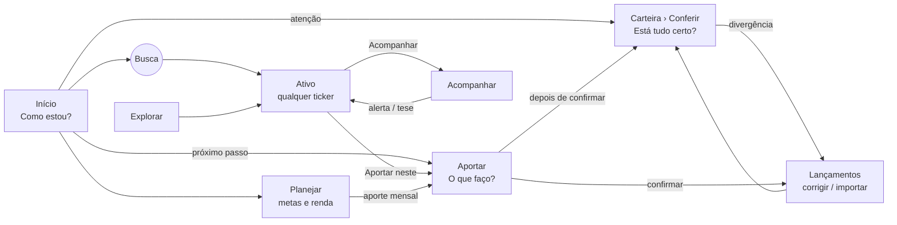
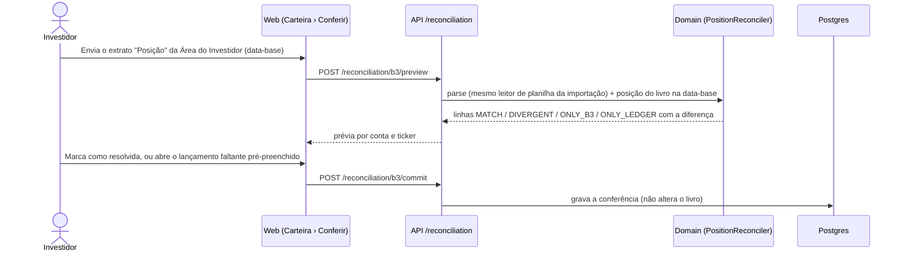

# Plano de Refatoração Sistêmica e de Experiência

*Data: 2026-11-01. Diagnóstico e benchmark em [REBUILD_ANALYSIS.md](./REBUILD_ANALYSIS.md).*
*Status: `[ ]` Proposta — registrada como Fase 48 em [IMPLEMENTATION_PLAN.md](../todo/IMPLEMENTATION_PLAN.md).*

---

## 1. Princípios

1. **A base é sagrada.** `fincontrol_pgdata` é a fonte da operação antes, durante e depois. Migrations só **aditivas** (`script_00040_*` em diante): novas tabelas, colunas anuláveis, índices e views. Nada de `DROP`, `RENAME` ou reescrita de linhas existentes. Coluna obsoleta fica e é ignorada pelo código.
2. **Reaproveitar antes de escrever.** Motores de domínio, repositórios, worker, provedores e MCP ficam. Código novo compõe o existente.
3. **Strangler, nunca big bang.** Cada fase entrega rotas novas funcionando sobre a mesma API e redireciona as antigas. Não existe "branch da reescrita".
4. **Contrato congelado onde não muda.** A Fase R1 (unificação de camadas) tem diff de OpenAPI igual a zero. MCP e web atuais continuam funcionando em todas as fases.
5. **Uma pergunta por tela, uma ação principal.** Divulgação progressiva: resumo → capítulo → detalhe.
6. **Regras do AGENTS.md valem integralmente:** código em inglês, testes de unidade em todo use case/repositório/componente, integração ao fim de cada fase, `docker compose build`, `IMPLEMENTATION_PLAN.md` atualizado.

---

## 2. Arquitetura-alvo

### 2.1 Backend

```text
controllers/<context>/        HTTP: valida request → chama handler → serializa read model em DTO
   │
domain/<context>/services/    Handlers (use cases): recebem Command/Query, abrem `with uow`,
   │                          devolvem READ MODELS de domínio (dataclasses) — nunca DTOs
domain/<context>/read_models  NOVO: formas de leitura por tela/agente (InstrumentView, PortfolioHub…)
domain/<context>/{entities, engines}   motores puros (inalterados)
domain/shared/{repositories, gateways, unit_of_work}   portas
   │
infra/data/…                  UoW, repositórios, models, migrations (inalterados + tabelas novas)
infra/providers, infra/mcp    inalterados; MCP passa a serializar read models como o controller
worker/                       inalterado + jobs dos novos read models
```

**Regras novas, verificadas por teste de arquitetura** (`tests/test_architecture_contracts.py`, sobre o grafo de imports que `test_import_graph.py` já percorre):

| De | Pode importar | Não pode importar |
|---|---|---|
| `domain` | `domain`, `core` | `controllers`, `infra`, `worker` |
| `controllers` | `domain`, `core`, `controllers` | `infra.data` (só via `composition`) |
| `infra` | `domain`, `core`, `infra` | `controllers` (o MCP usa serializers próprios ou os de `controllers.shared` movidos para `core/serialization`) |
| `worker` | `domain`, `infra`, `core` | `controllers` |

### 2.2 Identidade do instrumento (ticker-first)

Hoje o ativo só tem página depois de cadastrado (`assets.id`). O mercado abre qualquer ticker. O alvo:

- **`InstrumentKey`** = ticker normalizado (`domain/assets/services/codes.py` já normaliza) ou `TESOURO:<código>` para títulos.
- **`InstrumentView`** (read model) compõe, só lendo o banco:
  `instrument_catalog` + `market_data` + `asset_price_history` + `fundamental_snapshots` + `cvm_statements`/`cvm_documents` + lentes da recomendação + `asset_forecasts` + (se existir `assets` com o ticker) posição, checklist, tributação, proventos e lançamentos.
- `assets` continua sendo "o que eu acompanho ou possuo". Abrir um ativo **não** cria linha; "Acompanhar" cria (`register_researched_asset`, como hoje).
- Ticker que nunca foi gravado: a página mostra o que o catálogo tem e pede ao worker a primeira coleta (`market_request_job`), mesma regra da Fase 39 (sem chamada ao provedor na requisição).

### 2.3 Novos endpoints (todos somam; nenhum substitui)

| Rota | Handler | Compõe |
|---|---|---|
| `GET /search?q=&limit=` | `SearchQueryHandler` | `assets` (por ticker/nome) + `instrument_catalog` + catálogo do Tesouro; marca "na carteira", "acompanhando" |
| `GET /instruments/{ticker}` | `InstrumentViewHandler` | §2.2 — resumo, veredito das lentes, faixa da previsão, posição |
| `GET /instruments/{ticker}/{section}` | idem | `fundamentals`, `valuation`, `earnings`, `disclosures`, `prices?range=`, `forecast`, `checklist`, `tax`, `ledger` — delegam aos use cases atuais quando há `asset_id` |
| `GET /portfolio/hub?tab=` | `PortfolioHubHandler` | consolidação + analytics + health + by-account num read model por aba |
| `POST /reconciliation/b3/preview`, `POST /reconciliation/b3/commit`, `GET /reconciliation` | `PositionReconciliation*` | extrato de **Posição** da Área do Investidor × posição do livro por ticker e conta |
| `GET /tax/monthly?year=`, `GET /tax/monthly/{yyyy-mm}` | `MonthlyTaxAssessment*` | lucro realizado do livro + regras de `domain/tax` (fecha TD-04) |
| `GET/POST/PUT/DELETE /goals` | `Goal*` | metas de patrimônio e renda passiva; progresso pelo snapshot |
| `GET /portfolio/income-forecast?months=` | `IncomeForecastHandler` | proventos declarados + histórico de DY por ativo |
| `GET/POST/DELETE /alerts/rules` | `AlertRule*` | alertas de preço/indicador do usuário, avaliados pelo worker |
| `GET/POST/PUT /assets/{id}/notes` | `AssetNote*` | diário de tese (data, texto, gatilho de revisão) |

### 2.4 Tabelas novas (aditivas)

| Migration | Tabela | Uso |
|---|---|---|
| `script_00040_position_reconciliations` | `position_reconciliations`, `position_reconciliation_lines` | cada conferência (data-base, arquivo, hash) e cada linha (ticker, conta, qtd B3, qtd livro, diferença, status `MATCH`/`DIVERGENT`/`ONLY_B3`/`ONLY_LEDGER`, resolução) |
| `script_00041_monthly_tax_assessments` | `monthly_tax_assessments` | apuração por mês e categoria (`STOCK_SWING`, `DAY_TRADE`, `FII`, `FOREIGN_ANNUAL`), prejuízo acumulado, imposto devido, status do DARF |
| `script_00042_goals` | `goals` | tipo (`WEALTH`, `PASSIVE_INCOME`), alvo, prazo, aporte mensal planejado |
| `script_00043_alert_rules` | `alert_rules` | ticker, métrica, operador, limite, ativo/inativo; disparo vira alerta comum em `GET /alerts` |
| `script_00044_asset_notes` | `asset_notes` | `asset_id`, data, texto, `review_at` |
| `script_00045_saved_views` | `saved_views` | filtros salvos do screener e da carteira (hoje em `sessionStorage`) |

Cada migration tem teste de `upgrade`/`downgrade` (como `test_phase8_migrations.py`) e roda contra uma cópia restaurada da base real antes do merge.

### 2.5 Frontend

```text
apps/web/src/
  app/            shell, rotas, provedores (cache de dados, tema, sessão)
  features/       por TAREFA: home, portfolio, instrument, explore, decide, plan, ledger, settings
    <feature>/    page.tsx (fina) + sections/ + hooks/ + tests/
  shared/         components/, viz/, api/ (http.ts, types.ts gerado), utils/
```

- **Cache de dados por chave** substitui `useApi` (TanStack Query ou equivalente mínimo próprio): o hub da carteira troca de aba sem recarregar o snapshot; a busca global faz *debounce* e cancela.
- **Busca global** (`Ctrl+K` / `/`) no topo de todas as telas: ticker, nome, título do Tesouro e também ações ("aportar", "importar extrato", "nova compra").
- Páginas atuais viram **seções** dentro das novas (§4.4 do diagnóstico). `pages/` é esvaziada até a Fase R9.
- Tokens de `theme.css`, `viz/*` e `components/*` mudam de pasta, não de código.

---

## 3. Experiência-alvo

### 3.1 Arquitetura de informação

De 18 itens em 4 seções para **7 destinos + busca**:

| Destino | Pergunta | Abas / conteúdo | Substitui |
|---|---|---|---|
| 🔎 **Busca global** | "onde está X?" | ticker, nome, ações rápidas | busca do screener |
| **Início** | Como estou? | manchete, patrimônio, resultado, *o que mudou desde a última visita*, atenção (top 5), próximo passo | Início |
| **Carteira** | Está tudo certo? | **Posições** · **Rentabilidade** · **Proventos** · **Raio-X** · **Conferir** · **Imposto** | Carteira, Desempenho, Saúde, Tesouro a mercado, patrimônio por conta |
| **Explorar** | O que existe por aí? | **Screener** · **Tesouro** · **Garimpo** · **Comparar** · **Fatos relevantes** | Pesquisar, Garimpo, Comparar ativos, Fatos relevantes |
| **Acompanhar** | O que estou vigiando? | **Lista** (watchlist com preço, veredito, margem) · **Alertas** (calculados + regras do usuário) · **Teses** (notas com revisão) | aba Em observação, alertas do Início |
| **Aportar** | O que faço com o dinheiro? | Valor → Classes → Ativos (com o *porquê* das lentes) → Confirmar → **Conferir** | Aportar, Recomendação (Escolhidos, Matriz, Comparar) |
| **Planejar** | Para onde vou? | **Metas** · **Renda futura** · **Simulações** (estudos) · **Comparar renda fixa** · **Modelo** (teste no passado, placar, rodadas da recomendação; qualidade das previsões) | Simular carteira, Comparar renda fixa, abas técnicas da Recomendação |
| **Lançamentos** | O que eu fiz? | Movimentações (compras, vendas, proventos, eventos) · Importar extrato | Lançamentos |
| ⚙ **Configurações** (rodapé) | — | Estratégia · Contas · Dados de mercado · Acesso agêntico | Configuração |

### 3.2 O storytelling da operação



O ciclo mensal fica explícito: **Conferir → Aportar → Lançar → Conferir**. O Início sempre aponta o próximo ato pendente ("Extrato de posição de outubro ainda não conferido", "R$ 2.000 a aportar", "3 teses para revisar").

### 3.3 Página do ativo (`/ativo/:ticker`)

Um só endereço para qualquer ativo; `/asset/:id` redireciona. A página é uma **história em capítulos** (rolagem com índice lateral, não abas escondidas), cada um com a conclusão no título:

| # | Capítulo | Conteúdo | Fonte (já existe) |
|---|---|---|---|
| 0 | **Cabeçalho** | ticker, nome, tipo, quadrante ARCA, preço e variação, idade da cotação; botões *Acompanhar* / *Aportar* / *Comparar* / *Nova compra* | catálogo, `market_data` |
| 1 | **Em resumo** | radar das lentes (Cerrado, qualidade, valuation, melhora, momentum, renda, risco) — o "snowflake" do projeto — e três frases geradas: ponto forte, ponto fraco, o que mudou | `recommendation.lenses` |
| 2 | **Na minha carteira** *(só se possui)* | quantidade, preço médio, resultado (capital × proventos), peso atual × alvo na classe, por conta | consolidação |
| 2′ | **Como entraria** *(se não possui)* | quadrante sugerido, quanto um aporte típico compraria, efeito no peso da classe | `assets.classify`, `contributions.simulate` |
| 3 | **Preço** | gráfico 6m/1a/2a/5a/máx com proventos e fatos relevantes marcados | `asset_price_history`, CVM |
| 4 | **Vale a pena?** | checklist do Cerrado (respostas automáticas e manuais, validade) e qualidade | checklist v2 |
| 5 | **Está barato?** | veredito por perfil, métodos (Graham, Bazin, P/VP…), margem, sensibilidade | valuation |
| 6 | **Resultados** | indicadores nos 5 grupos do mercado (valuation, endividamento, eficiência, rentabilidade, crescimento), lucro anual, balanços CVM | fundamentos, `cvm_statements` |
| 7 | **Proventos** | histórico por ano, DY, regularidade, próximos anunciados | `market_data`, `earnings` |
| 8 | **O que pode acontecer** | faixa provável em 3/6/12/24m, só com selo ≥ "Use com cautela" | `asset_forecasts` |
| 9 | **Notícias e eventos** | comunicados CVM com reação típica | `cvm_documents`, estudo de eventos |
| 10 | **Minha tese** | notas com data de revisão | `asset_notes` (novo) |
| 11 | **Imposto e lançamentos** *(só se possui)* | situação tributária, compras/vendas/proventos | `tax`, `ledger` |

Divulgação progressiva: cada capítulo abre com 1 frase + 1 número; "ver detalhes" expande a tabela que hoje é a aba inteira.

### 3.4 Carteira (`/carteira`)

| Aba | Responde | Inspiração |
|---|---|---|
| **Posições** | o que tenho, agrupado por classe ARCA, peso × meta × banda; filtro por conta e por meta | Status Invest *Patrimônio* |
| **Rentabilidade** | quanto rendeu em qualquer período, separando **valorização, proventos e câmbio**; multi-período; contra CDI/IPCA/IBOV/IFIX/S&P; contribuição de cada ativo | Sharesight *Performance* |
| **Proventos** | recebidos por mês/ano, *yield on cost*, agenda declarada, **renda futura 12–36 m** | Snowball, Sharesight *Future income* |
| **Raio-X** | concentração, setor, exposição *dentro* dos ETFs, risco (os 7 pilares da Saúde), drawdown | Morningstar *X-Ray* |
| **Conferir** | posição do livro × extrato de Posição da B3 por ticker e conta; cotações velhas; livro inválido; corrigir com um clique levando a Lançamentos | — (nenhum concorrente faz sem integração) |
| **Imposto** | apuração do mês por categoria, prejuízo a compensar, DARF a pagar, venda que dispara imposto | myProfit, Investidor10 DARF |

### 3.5 Conferência de posição (validar posição)



A conferência **nunca** escreve no livro; ela aponta e pré-preenche. A última conferência e sua data aparecem no Início e no alerta "posição não conferida há N dias".

### 3.6 Aportar (`/aportar`)

Etapas atuais mantidas, com a recomendação embutida:

1. **Valor** (sugerido pelas metas de Planejar)
2. **Classes** — antes × depois × meta (já existe)
3. **Ativos** — cada linha com o radar das lentes e o "por que este e não aquele" (`recommendation.compare`), botão para trocar
4. **Confirmar** — data e conta (já existe)
5. **Conferir** — novo: depois de confirmar, mostra a posição esperada para conferir com a nota de corretagem

As abas técnicas da Recomendação (Matriz, Teste no passado, Placar, Rodadas) vão para **Planejar › Modelo**.

### 3.7 Padrões visuais

- Cabeçalho de página: **pergunta** como título, **resposta** como subtítulo gerado ("Sua carteira rendeu 1,2% no mês, 0,3 p.p. acima do CDI").
- Cartão-veredito antes de toda tabela; tabela em "ver detalhes".
- Estado de dado sempre visível: idade da cotação, fallback, selo de confiança (regra "erro nunca vira zero" da ADR 0007).
- Mobile: os 7 destinos viram barra inferior com 5 itens (Início, Carteira, Busca, Aportar, Mais).

---

## 4. Fases

Cada fase termina com: testes de unidade e integração (`uv run pytest`, `npm test`), `docker compose build`, golden tests verdes, `pg_dump` antes do `alembic upgrade`, e atualização do `IMPLEMENTATION_PLAN.md` e do `OVERVIEW.md`.

| Fase | Nome | Entregas | Critério de pronto | Depende |
|---|---|---|---|---|
| **R0** | Guarda-corpos | `tests/test_architecture_contracts.py` (inicialmente com a lista de violações atual como *allowlist* que só pode diminuir); snapshot do OpenAPI versionado; script de restauração de cópia da base para teste de migração; smoke E2E Playwright das 10 jornadas atuais | CI local verde; allowlist com 25 + 10 entradas | — |
| **R1** | Unificação das camadas | use cases devolvem read models; DTOs só em `controllers`; portas no lugar de `infra` dentro de `domain`; MCP serializando read models; `health.py` dividido por pilar; `OVERVIEW.md` §2.1 corrigido | allowlist vazia; **diff de OpenAPI = 0**; golden e caracterização iguais | R0 |
| **R2** | Instrumento por ticker e busca | `InstrumentView`, `GET /instruments/{ticker}[/section]`, `GET /search`; MCP `instruments.get`, `search` | qualquer ticker do catálogo abre sem cadastro; nenhum provedor chamado na requisição | R1 |
| **R3** | Novo shell e arquitetura de informação | `app/` + `features/`; cache de dados; busca global `Ctrl+K`; 7 destinos; rotas em pt-BR (`/carteira`, `/ativo/:ticker`, `/explorar`, `/acompanhar`, `/aportar`, `/planejar`, `/lancamentos`) com **redirecionamento** de todas as rotas antigas | toda URL antiga leva ao lugar novo; testes de navegação | R2 |
| **R4** | Página do ativo em capítulos | §3.3 com as abas atuais reaproveitadas como seções; "Como entraria" para não possuído | `/asset/:id` redireciona; mesmo dado que as abas atuais (teste contra `mockApi`) | R3 |
| **R5** | Hub da carteira + Conferir | abas §3.4 (Posições, Rentabilidade, Proventos, Raio-X); `script_00040`; conferência de posição §3.5 | conferência do extrato real bate ou explica cada diferença; Desempenho e Saúde redirecionam | R3 |
| **R6** | Acompanhar e Aportar unificados | watchlist + alertas + teses; `script_00043`, `script_00044`; worker avalia `alert_rules`; Aportar §3.6; Recomendação técnica → Planejar › Modelo | mesmo plano de aporte que hoje para o mesmo valor (teste de regressão) | R4 |
| **R7** | Imposto mensal | `script_00041`; apuração por categoria, isenção de R$ 20 mil em ações, compensação, exterior anual (Lei 14.754/2023); aba Imposto; alerta de DARF; **fecha TD-04** | casos de teste da Receita/golden de IR | R5 |
| **R8** | Planejar | `script_00042`, metas; renda futura; simulações reposicionadas; incorpora as propostas **34** (composição ótima) e **36** (carteiras de comparação) se aprovadas | meta mostra progresso e aporte necessário | R5 |
| **R9** | Remoção do legado | apaga `pages/` antigas, `useApi`, rotas de redirecionamento com mais de 2 fases; `saved_views` (`script_00045`); relatório mensal em PDF | nenhum import de `pages/`; docs atualizados | R4–R8 |

Paralelismo possível: depois de R3, **R4** (ativo) e **R5** (carteira) não tocam os mesmos arquivos; **R7** e **R8** são independentes entre si.

---

## 5. Mapa de reaproveitamento (tela atual → destino)

| Atual (`apps/web/src/pages`) | Destino | Como |
|---|---|---|
| `home/HomePage.tsx`, `story.ts`, `QuoteClock`, `DeclaredEarnings`, `LatestStudy` | Início | mantidos; ganha "o que mudou" e "próximo passo" |
| `portfolio/PortfolioPage.tsx`, `home/AccountsWealth.tsx` | Carteira › Posições | seção |
| `performance/PerformancePage.tsx` | Carteira › Rentabilidade | seção + separação câmbio |
| `health/HealthPage.tsx`, `portfolio/TreasuryMarketPanel.tsx` | Carteira › Raio-X | seções |
| `asset/AssetDetailPage.tsx` + `ChecklistTab`, `ForecastTab`, `TaxTab`, `MarketTab`, `CvmStatements`, `PriceHistory` | Ativo (capítulos) | cada aba vira capítulo |
| `asset/AssetFormPage.tsx` | Ativo › editar cadastro | mantido |
| `research/ResearchPage.tsx`, `useScreenerSearch.ts` | Explorar › Screener / Tesouro; Acompanhar › Lista | dividido em 3 |
| `research/MiningPage.tsx` | Explorar › Garimpo | mantido |
| `tools/AssetComparePage.tsx` | Explorar › Comparar | mantido |
| `disclosures/*` | Explorar › Fatos relevantes; capítulo 9 do ativo | mantido |
| `recommendation/RecommendationPage.tsx`, `Optimized`, `LiveScoreboard` | Aportar (porquê) + Planejar › Modelo | dividido |
| `contribute/ContributePage.tsx`, `Rationale.tsx` | Aportar | mantido + etapa Conferir |
| `simulation/*` | Planejar › Simulações | mantido |
| `tools/FixedIncomeComparePage.tsx` | Planejar › Comparar renda fixa | mantido |
| `ledger/*` | Lançamentos | mantido |
| `settings/*` | Configurações | mantido |

---

## 6. Fora do escopo (decisões)

- **Integração automática B3 / Open Finance:** a API da Área do Investidor é licenciada a instituições; a conferência por extrato cobre a necessidade de validar posição sem esse custo.
- **Multiusuário:** continua ferramenta pessoal (TD-01).
- **Troca de stack:** FastAPI, SQLAlchemy, Alembic, React e Vite ficam.
- **Recomendação personalizada como conselho:** a ferramenta continua sendo método e simulação; nada executa ordens.

---

## 7. Itens para aprovação

1. Renomear as rotas para pt-BR (`/carteira`, `/ativo/:ticker`) ou manter em inglês (`/portfolio`, `/instrument/:ticker`)? *(o AGENTS.md exige inglês em rotas da API; rotas do SPA são UI — recomendação: pt-BR no web, inglês na API.)*
2. Adotar TanStack Query no web (primeira dependência de runtime além de React/Router) ou manter cache próprio?
3. Ordem R4 × R5: começar pela página do ativo (encontrar) ou pela conferência de posição (validar)?
4. As propostas 34, 36 e 47 entram em R8 ou ficam como estão?
