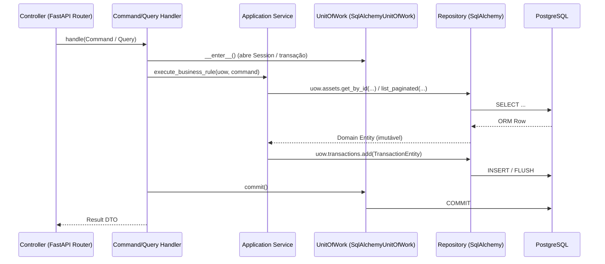

# ADR 0004 — Isolamento de Componentes Backend (Controllers, Handlers, Services, Unit of Work e Repositories)

- **Status:** Aceito
- **Data:** 2026-10-24

## Contexto
Para evitar acoplamento entre a camada HTTP (`FastAPI`), as regras de negócio (`apps/packages/core`) e o banco de dados (`SQLAlchemy`), precisamos garantir que cada camada tenha responsabilidade única, fronteiras bem definidas por interfaces (Protocols/ABCs) e que os controllers jamais manipulem modelos de banco ou sessões diretamente.

## Decisão
Adotar os seguintes padrões de projeto em todo o backend (`apps/packages/core`, `apps/packages/persistence`, `apps/api`, `apps/worker`):

1. **Entidades de Domínio e Mappers (`Domain Entities` $\leftrightarrow$ `ORM Models`)**:
   - Os repositórios recebem e devolvem **Entidades de Domínio imutáveis** (`AssetEntity`, `FixedIncomeTermEntity`, `TransactionEntity`, `EarningEntity`, `ArcaTargetEntity`, `MarketSeriesPoint`, `PortfolioSnapshotEntity`) definidas em `apps/packages/core/domain/entities.py`.
   - Modelos SQLAlchemy (`AssetModel`, etc.) ficam encapsulados dentro de `apps/packages/persistence` e nunca vazam para os Controllers ou para o `apps/packages/core`.
2. **Repository Pattern (`AbstractRepository` $\rightarrow$ `SqlAlchemyRepository`)**:
   - Interfaces abstratas definidas em `apps/packages/core/ports/repositories.py`.
   - Implementações concretas em `apps/packages/persistence/src/fincontrol_persistence/repositories/<feature>.py` (um módulo por feature; os models ORM seguem o mesmo corte em `models/<feature>.py`).
   - Repositórios executam queries, filtros, ordenação e paginação (`PaginatedResult[DomainEntity]`), mas **nunca** chamam `session.commit()`.
3. **Unit of Work Pattern (`AbstractUnitOfWork` $\rightarrow$ `SqlAlchemyUnitOfWork`)**:
   - Interface definida em `apps/packages/core/ports/unit_of_work.py` e implementação concreta em `apps/packages/persistence/src/fincontrol_persistence/core/unit_of_work.py`; na API, só `composition.py` escolhe a implementação concreta.
   - Gerencia o ciclo de vida da sessão e a atomicidade da transação (`with uow: ... uow.commit()`), expondo os repositórios (`uow.assets`, `uow.transactions`, `uow.earnings`, `uow.arca_targets`, `uow.market_series`, `uow.snapshots`).
4. **Services (`Application / Domain Services`)**:
   - Coordenam regras de negócio complexas que envolvem múltiplos agregados, cálculos financeiros do `core` e provedores externos (`MarketDataGateway`).
5. **Handlers (`Command / Query Handlers`)**:
   - Cada caso de uso da aplicação (ex.: `RegisterAssetHandler`, `RecordTransactionHandler`, `GetPortfolioConsolidatedQueryHandler`) recebe um Command/Query tipado, abre o `UnitOfWork`, aciona os `Services` e persiste de forma atômica.
6. **Controllers (`FastAPI Routers`)**:
   - Atuam apenas como adaptadores HTTP: validam o payload de entrada (Pydantic), invocam o `Handler`/`Service` injetado via `Depends()` e retornam o DTO de resposta. **É proibido injetar `Session` ou `Repository` em um Controller.**

## Diagrama de Sequência entre as Camadas

## Atualização (2026-10-25) — Módulos por feature

A API passou a seguir o layout por módulos do projeto de referência (`dynamic-research`): `fincontrol_api/core/` concentra a infraestrutura HTTP (configuração, segurança, dependências, middleware, tradução de erros) e cada feature tem a própria pasta em `fincontrol_api/modules/<feature>/` com `router.py` (controllers), `schemas.py`, `use_cases.py` (handlers), `dependencies.py`, `serializers.py` e, quando há, `service.py`. O persistence foi cortado do mesmo jeito (`models/`, `repositories/`, `mappers/` por feature), mas continua num pacote compartilhado em `apps/packages/`, porque o worker usa a mesma Unit of Work e os mesmos repositórios. As regras desta ADR não mudam. A decisão completa está na ADR 0008.
